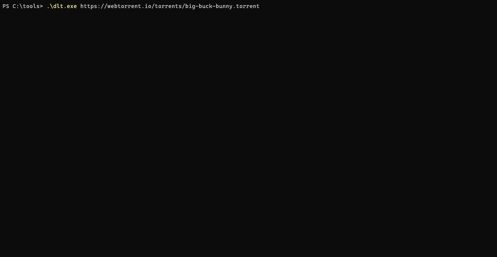

# dlt

A dead simple torrent downloader, like `curl`, but for torrents.



`dlt` is a single binary with nothing to install that exits when the download is done. A lightweight torrent client for when you're not seeding, and don't want to install anything, or change the file system other than the torrent being downloaded. No pause, queue or state is maintained. `dlt` downloads the torrent and goes away.

Use with torrents or magnet links:

```shell
user@host:~$ dlt https://webtorrent.io/torrents/big-buck-bunny.torrent
```

```shell
user@host:~$ dlt "magnet:?xt=urn:btih:dd8255ecdc7ca55fb0bbf81323d87062db1f6d1c&dn=Big+Buck+Bunny&tr=udp://tracker.opentrackr.org:1337"
```

Full torrent clients can be heavy, built to manage a library of active torrents: background services, tray icons, web UIs, open ports, download and upload queues, ratios, scheduling. `dlt` is the opposite.

- **Single executable.** Drop it in a folder, or on a USB stick, and run it.
- **Lightweight.** No daemon, web server, database, or tray icon.
- **Foreground only.** Downloads and goes away. Nothing left running.
- **One torrent per run.** No queue, no pause. Run again after an interruption and it checks what's already on disk and fetches the rest.
- **Leaves no trace.** The download is the only thing written. No config, no state, no history.
- **Tracker driven.** Probes every tracker and picks the strongest. No DHT, no local peer discovery.
- **Download only.** No uploads, no open ports, unless you pass `--seed`.

## Usage

```
dlt <magnet | file.torrent | https://.../file.torrent> [--out <dir>] [--select] [--seed]
```

| Option | Description |
|---|---|
| `--out <dir>` | Save into this directory. Created if missing. Default is the current directory. |
| `--select` | Prompts the user to select which tracker to use, instead of picking the one with the most seeds. |
| `--seed` | Turn uploads on, accept incoming peers, and keep running as a seed after the download. Stop it with Ctrl+C. |

## Alternatives

If you want a client that runs in the background, seeds for the long haul, finds peers over DHT, pauses and resumes, queues torrents, picks individual files out of a multi-file torrent, or forwards ports, use a full one:

- [qBittorrent](https://www.qbittorrent.org/)
- [Transmission](https://transmissionbt.com/)
- [Deluge](https://deluge-torrent.org/)
- [rTorrent](https://github.com/rakshasa/rtorrent)
- [Tixati](https://www.tixati.com/)
- [BiglyBT](https://www.biglybt.com/)
- [aria2](https://aria2.github.io/)
- [WebTorrent](https://webtorrent.io/)
